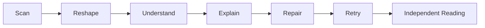
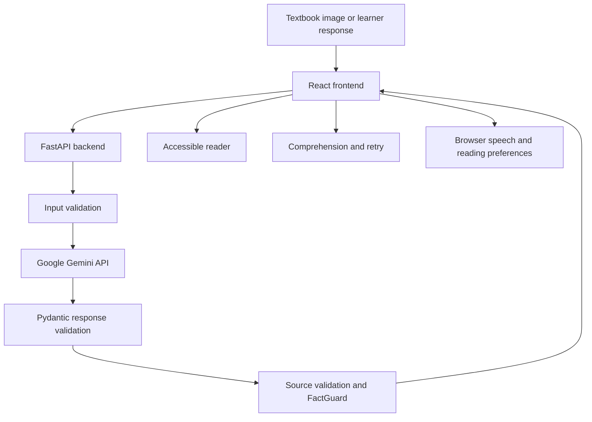

<div align="center">

# MindBridge

### Every page understood. Not just read.

An AI-powered, accessibility-first learning companion that bridges the gap between reading a textbook and truly understanding it.


**Team WHACKERS · wHACKiest 2026 · UnlockED**

[Features](#features) · [Innovation](#signature-innovation) · [Architecture](#architecture) · [Getting started](#getting-started)

</div>

---

## Overview

MindBridge turns printed textbook pages into personalised, interactive learning experiences. It combines accessible reading tools with AI-assisted explanations, original-source transparency and formative comprehension feedback.

Rather than replacing textbooks with AI-generated summaries, MindBridge guides learners back to the original material with a clearer understanding of the concepts.

## The problem

Dense textbook layouts, unfamiliar vocabulary and complex sentences create barriers for students with reading difficulties, second-language learners and students who need additional learning support.

Reading a passage does not necessarily mean understanding it. A student may memorise information while retaining misconceptions that remain unnoticed without personalised feedback.

MindBridge addresses both challenges: **access to the text and understanding of the concepts.**

## The learning journey



## Signature innovation

### Source-Linked Understanding Loop

MindBridge connects accessible reading, source-grounded explanations and active comprehension practice into a single learning journey.

| Innovation | How it works |
| --- | --- |
| **SourceLens** | Links simplified explanations to their original extracted textbook passages, allowing learners to compare the two and inspect the source photograph. |
| **Misconception Repair** | Evaluates a learner's explanation against a source-grounded rubric, identifies possible misconceptions and missing concepts, and offers targeted feedback. |
| **Independent Retry** | Presents a different question about the same concept after feedback and compares the concepts demonstrated across attempts. Conceptual assistance is tracked separately. |
| **FactGuard** | Flags possible omissions or changes involving important numbers, units and terminology in simplified content. |
| **Reading Ladder** | Supports gradual, voluntary movement from simplified content to original textbook wording while retaining accessibility settings. The MVP focuses on Original and Simplified modes. |

The central distinction is the feedback loop: a learner does not simply receive an easier version of the text, but gets an opportunity to explain, repair and retry their understanding.

## Features

| Smart textbook scanning | Accessible reading |
| --- | --- |
| Camera capture and image upload | Adjustable fonts and text size |
| Image preview and validation | Customisable line, letter and word spacing |
| AI-powered OCR | Reading themes and configurable reading width |
| Structured headings and paragraphs | Text-to-speech with sentence highlighting |
| Image quality checks and retake guidance | Original and Simplified reading modes |

| AI-assisted understanding | Interactive learning |
| --- | --- |
| Contextual vocabulary definitions | Source-grounded comprehension questions |
| Textbook summaries | Open-ended student explanations |
| Section-level simplification | Identification of possible misconceptions |
| Contextual concept explanations | Targeted feedback and learning hints |
| SourceLens and FactGuard | Independent retry and concept-based results |

## Example learning experience

Consider a textbook passage explaining photosynthesis.

**Student explanation:**
> Plants get their food directly from sunlight.

**Illustrative MindBridge feedback:**
> Sunlight provides energy. Plants use this energy to produce glucose from carbon dioxide and water.

**Independent retry:**
> What does sunlight provide, and which materials do plants use to make glucose?

The learner can revisit the original passage, answer a different question and return to original reading with their preferred accessibility settings intact.

*This is an illustrative learning example, not a recorded model response or measured educational outcome.*

## Architecture

MindBridge uses a React frontend and a modular, stateless FastAPI backend. The architecture keeps original extracted text separate from AI-generated content and validates source references before presenting them to the learner.



The MVP is scoped to one English printed textbook page at a time, with no user accounts or dedicated server database.

### API overview

| Method | Endpoint | Purpose |
| --- | --- | --- |
| GET | `/api/health` | Service status and feature capabilities |
| POST | `/api/read` | Extract and structure textbook content |
| POST | `/api/simplify` | Generate source-linked simplified sections |
| POST | `/api/define` | Provide contextual vocabulary definitions |
| POST | `/api/explain` | Explain a selected concept |
| POST | `/api/prepare-understanding` | Prepare a learning objective, rubric and initial question |
| POST | `/api/check-understanding` | Evaluate explanations, provide repair feedback and assess retry attempts |

## Technology stack

| Layer | Technology |
| --- | --- |
| Frontend | React, Vite, JavaScript, React Router |
| Styling | Tailwind CSS, CSS variables |
| Backend | Python, FastAPI |
| AI integration | Google Gemini API, Google Gen AI SDK |
| Validation | Pydantic, structured JSON, Pillow |
| Read aloud | Web Speech API |
| Reading preferences | Browser localStorage |
| Testing tools | Pytest, Vitest, React Testing Library, Playwright |
| Hosting configuration | Vercel (frontend), Render (backend) |

## Getting started

### Prerequisites

- Python 3.12
- Node.js 22.12+ (Node 22) and npm
- A Google Gemini API key with access to a compatible multimodal model

Clone this repository using its GitHub **Code** menu, then open the project root in a terminal.

### 1. Backend

```bash
cd backend
python -m venv .venv
source .venv/bin/activate
pip install -r requirements.txt
```

For Windows PowerShell, activate the virtual environment using `.venv\Scripts\Activate.ps1` instead.

Create `backend/.env` using the backend environment template. Configure the Gemini API key, a supported model ID, and the permitted frontend origin. For local development, the documented configuration is:

```dotenv
GEMINI_API_KEY=
GEMINI_MODEL=gemini-3.5-flash-lite
ALLOWED_ORIGINS=http://localhost:5173
APP_ENV=development
```

Enter your own key and verify model availability for your account. Never commit the `.env` file or expose the key to the frontend.

Start the backend from the `backend` directory:

```bash
uvicorn app.main:app --reload --port 8000
```

### 2. Frontend

Open another terminal at the project root:

```bash
cd frontend
npm ci
```

Create `frontend/.env` with:

```dotenv
VITE_API_BASE_URL=http://localhost:8000
```

Start the frontend:

```bash
npm run dev
```

| Local service | Address |
| --- | --- |
| MindBridge | http://localhost:5173 |
| FastAPI | http://localhost:8000 |
| Interactive API documentation | http://localhost:8000/docs |

## Accessibility and responsible AI

MindBridge is designed with students in Classes 6–10, second-language learners and learners who benefit from configurable reading support in mind.

- Student-controlled reading assistance, with accessibility settings retained across reading modes.
- Semantic interfaces, keyboard accessibility, readable typography and responsive layouts as design priorities.
- Clear distinction between original extracted text and AI-generated explanations.
- Formative feedback focused on conceptual understanding rather than spelling or grammar.
- No fabricated grades, mastery percentages or claims of verified independent work outside the application.
- Backend-only API credentials and minimal personal data collection.

**Limitations:** OCR can introduce errors, AI feedback can be incorrect, and FactGuard provides possible omission warnings rather than a guarantee of factual accuracy. Browser speech support varies by device. MindBridge is a hackathon prototype, not a medical diagnostic tool or a validated educational assessment. Images and answers are processed externally by the configured AI provider; real student deployment requires a permitted provider arrangement and appropriate child-data safeguards.

## Future scope

The architecture provides room for a full Easy–Guided–Original Reading Ladder, regional-language explanations, saved textbook pages, offline reopening, vocabulary revision and richer diagram support.

## Team WHACKERS

**Information Science and Engineering**  
M.S. Ramaiah Institute of Technology

| Hackathon | Track |
| --- | --- |
| wHACKiest 2026 · November 26–27, 2026 | UnlockED — Unlocking Educational Potential, Empowering Futures |

---

<div align="center">

**MindBridge — Every page understood. Not just read.**

Built to make understanding more accessible.

</div>
